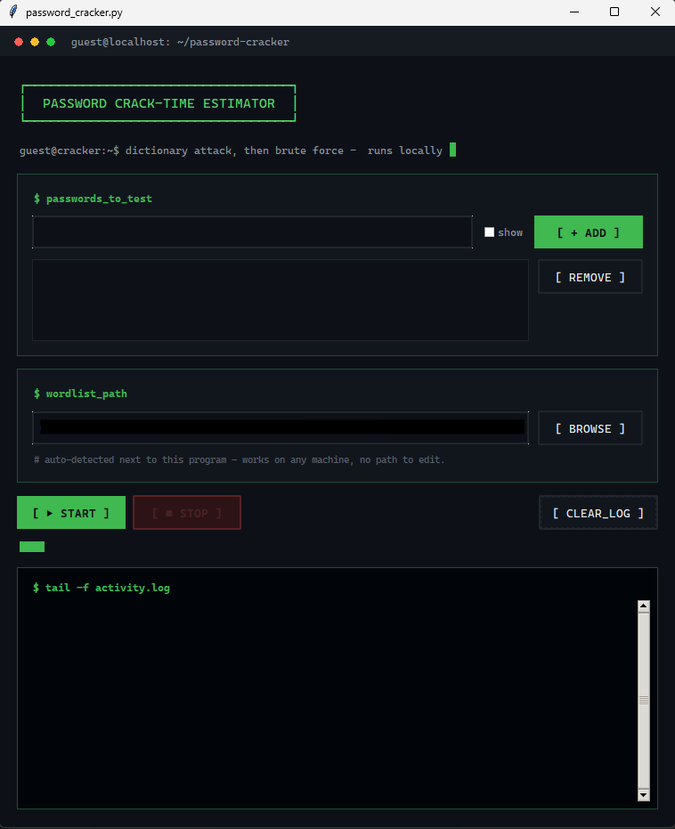
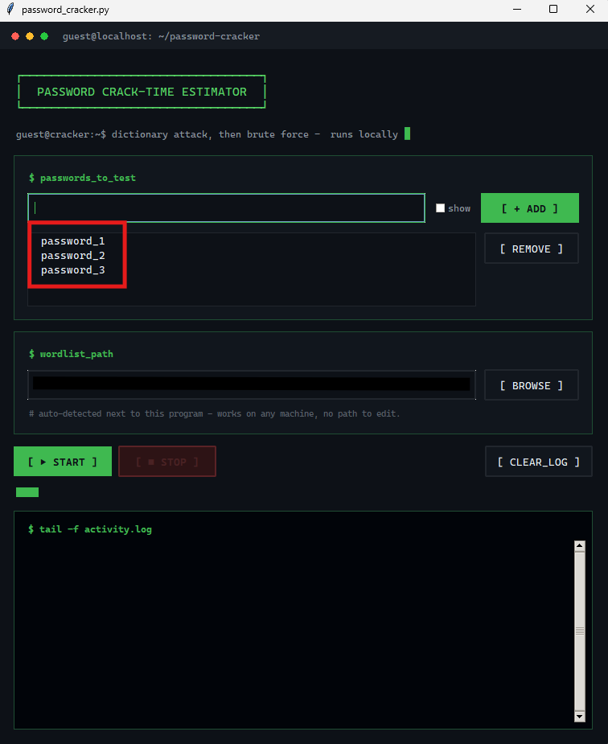
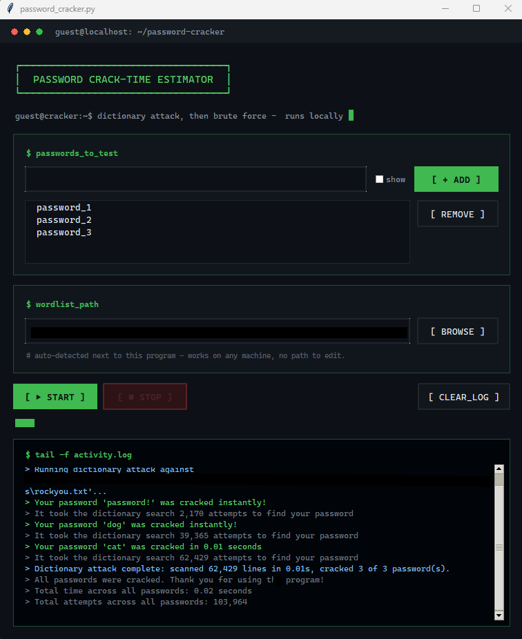

<h1 align="center">Credential Attack Simulation Tool</h1>

<p align="center">
A Python-based cybersecurity tool that simulates password attacks using dictionary and brute-force techniques. Available as both a desktop GUI and command-line application. Source runs on Windows and Linux with Python and tkinter.
</p>

<p align="center">

</p>

## Overview

The **Credential Attack Simulation Tool** is an educational password auditing program designed to demonstrate how passwords can be recovered using common credential attack techniques.

The program follows a two-stage attack process:

1. **Dictionary Attack** – Tests the target passwords against a user-provided password wordlist.
2. **Brute-Force Attack** – If a password is not found in the dictionary, the program attempts to generate character combinations until the password is found or the configured length limit is reached.

The tool supports testing up to **100 passwords** at a time and records:

* Number of attempts
* Time elapsed
* Attack method used
* Whether the password was discovered

For each target, an attempt represents one usable dictionary candidate or brute-force combination. Blank dictionary lines do not count. Brute-force totals include prior unsuccessful dictionary attempts; the overall total sums the per-target attempt counts rather than counting unique candidate strings once. Per-target elapsed times include both phases.

The brute-force engine can generate combinations using:

* Uppercase letters
* Lowercase letters
* Numbers
* Symbols

Brute-force attacks are limited to passwords of **8 characters or fewer** because the search space becomes extremely large as password length increases. Passwords longer than the limit are reported rather than brute-forced.

## Key Features

* Dictionary-based password attacks
* Automatic fallback to brute force
* Support for multiple passwords
* Attack timing and attempt statistics
* GUI and CLI interfaces using the same core engine
* GUI activity log with color-coded results
* Stop button for cancelling long-running brute-force attacks
* Confirmation before starting potentially long brute-force searches
* User-selectable password dictionaries
* Windows and Linux executables can be built from source using PyInstaller

## How It Works

```text
                Start
                  |
                  v
          Select Dictionary
                  |
                  v
           Enter Passwords
                  |
                  v
          Dictionary Attack
                  |
          +-------+-------+
          |               |
       Found          Not Found
          |               |
          v               v
        Result       Brute-Force Attack
                          |
                    +-----+-----+
                    |           |
                  Found      Not Found
                    |           |
                    v           v
                  Result    Report Result
```

## Using the GUI

The GUI is designed for a simple workflow:

1. Launch the program.
2. Click **Browse** and select a password dictionary.
3. Enter one or more passwords to test.
4. Start the attack.
5. Review the results in the activity log.

The GUI requires a readable local wordlist file before starting. The CLI also accepts a manually entered path.

The example screenshots illustrate a local wordlist such as `rockyou.txt`. Select any compatible newline-separated text file.

### Main window

<p align="center">

</p>

### Add passwords for testing

<p align="center">

</p>

### View attack results

<p align="center">

</p>

## Installation and Running

The program has two entry points: `src/password_cracker_gui.py` (desktop GUI) and `src/password_cracker.py` (interactive CLI). Both import `src/password_cracker_core.py`. Run these commands from the **repository root**, not the `src` folder.

### Prerequisites

- Python **3.9 or newer** for running source code.
- No third-party Python runtime dependencies: `requirements.txt` documents this.
- The GUI requires `tkinter`. Windows Python installers from [python.org](https://www.python.org/downloads/) usually include it. On Ubuntu/Debian Linux, install it with `sudo apt install python3-tk` if necessary. The CLI does **not** need Tkinter.
- A local newline-separated password dictionary (`.txt`) chosen by the user. Wordlists are **not** bundled with the program or executables.

### Run from Python source (Windows)

Open PowerShell in the repository root:

```powershell
py -m pip install -r requirements.txt
py src/password_cracker_gui.py
```

For the **CLI** instead:

```powershell
py src/password_cracker.py
```

If the `py` launcher is unavailable, replace `py` with `python`.

### Run from Python source (Linux)

On Ubuntu/Debian, install Tkinter if you want the GUI:

```bash
sudo apt update
sudo apt install python3-tk
```

From the repository root:

```bash
python3 -m pip install -r requirements.txt
python3 src/password_cracker_gui.py
```

For the **CLI** instead:

```bash
python3 src/password_cracker.py
```

`pip install -r requirements.txt` is optional here because the application has no third-party runtime dependencies. Linux distributions that externally manage Python may disallow system-wide `pip` installs; use a virtual environment for build tools as shown below.

### Using the application

**GUI:** launch it, browse to a readable `.txt` wordlist, enter up to 100 controlled test passwords, and start the attack. Results appear in the activity log; Stop requests cancellation.

**CLI:** launch it, follow the prompts for the number of passwords and their values, enter the dictionary file path, and review the attempt totals and method in the terminal. A default dictionary path may be offered, but you can enter your own.

## Standalone Executables

If prebuilt executables are published under [GitHub Releases](../../releases), download the version built for your operating system. Releases are optional; the instructions below explain how to build your own. **A Windows `.exe` will not run natively on Linux, and a Linux binary will not run natively on Windows. Build on the target operating system.**

### Windows: build and run the GUI-only `.exe`

In PowerShell, from the repository root:

```powershell
py -m pip install --upgrade pyinstaller
py -m PyInstaller --noconfirm --clean --onefile --windowed --name CredentialAttackSimulationTool --icon "assets/app_icon.ico" --add-data "assets/app_icon.ico;assets" "src/password_cracker_gui.py"
.\dist\CredentialAttackSimulationTool.exe
```

The output is `dist\CredentialAttackSimulationTool.exe`. It opens the **GUI only**, without a separate terminal. No Python installation is required on the target Windows PC. The Windows-native dark title bar is enabled where supported. The user selects a wordlist at runtime.

### Linux: build and run the GUI executable

Install Python, Tkinter and virtual-environment support as appropriate for your distribution. For Ubuntu/Debian:

```bash
sudo apt update
sudo apt install python3 python3-tk python3-venv
python3 -m venv .venv
source .venv/bin/activate
python -m pip install --upgrade pyinstaller
python -m PyInstaller --noconfirm --clean --onefile --windowed --name CredentialAttackSimulationTool --add-data "assets/app_icon.ico:assets" src/password_cracker_gui.py
./dist/CredentialAttackSimulationTool
```

The output is `dist/CredentialAttackSimulationTool` (no `.exe` extension). Run it from a Linux desktop session with a graphical display. If needed after copying it to another system, mark it executable using `chmod +x CredentialAttackSimulationTool`. The Linux window title bar and controls use the desktop environment's native theme, not the Windows-specific dark-title-bar setting.

**Linux compatibility:** Build on a Linux system compatible with the target machine's architecture and system libraries; a binary built on a newer distribution may not run on older ones. The `.ico` asset is packaged for the application, but Linux desktops typically need a separately configured `.desktop` launcher to show an icon in application menus.

### Optional: package the CLI instead

The main executable builds above are GUI-only. If you also want a CLI binary, run the relevant build command with `src/password_cracker.py` as the entry point, omit `--windowed`, and choose a different `--name` (e.g. `CredentialAttackSimulationCLI`). The normal source-based CLI commands above require no packaging.

### Testing

Run the regression suite from the repository root:

```bash
python -m unittest discover -s tests -v
```

On Linux, replace `python` with `python3` if not using a virtual environment. Test the executable on the intended platform, including file browsing, dictionary matches, brute-force fallback with a short test password, results, and cancellation. Rebuild executables after modifying Python source or packaged assets. PyInstaller is a **build-time** tool and is not listed as a runtime dependency.

## Password Dictionaries

The program accepts a user-provided password dictionary.

For example:

```text
rockyou.txt
```

The wordlist should contain one password per line.

The tool does **not** require `rockyou.txt` specifically. Any compatible password dictionary can be selected through the GUI or provided through the CLI workflow.

## Technologies

### Language

* **Python 3.9+**

### Libraries

* Python standard library
* `tkinter` for the desktop GUI

No third-party Python packages are required to run the source code.

### Dataset

* `rockyou.txt` or another user-provided password dictionary

## Tests

From the repository root, run the built-in regression suite:

```bash
python -m unittest discover -s tests -v
```

The suite checks dictionary matches, duplicate targets, attempt totals, invalid wordlists, search limits, and brute-force fallback. GUI/CLI smoke testing and rebuilding compiled executables are separate steps.

## Educational Purpose

This project was created for educational and cybersecurity research purposes.

It demonstrates:

* Password security weaknesses
* Dictionary-based credential attacks
* Brute-force attack techniques
* The impact of password length and complexity
* The computational limitations of password cracking

**Only use this tool with passwords, systems, or accounts that you own or have explicit authorization to test.**

## Future Improvements

Possible future enhancements include:

* Multiprocessing for faster brute-force searches
* GPU-accelerated cracking
* Hash-based password cracking
* Password entropy analysis
* Exportable attack reports
* Additional wordlist presets
* Expanded configuration options for brute-force character sets
